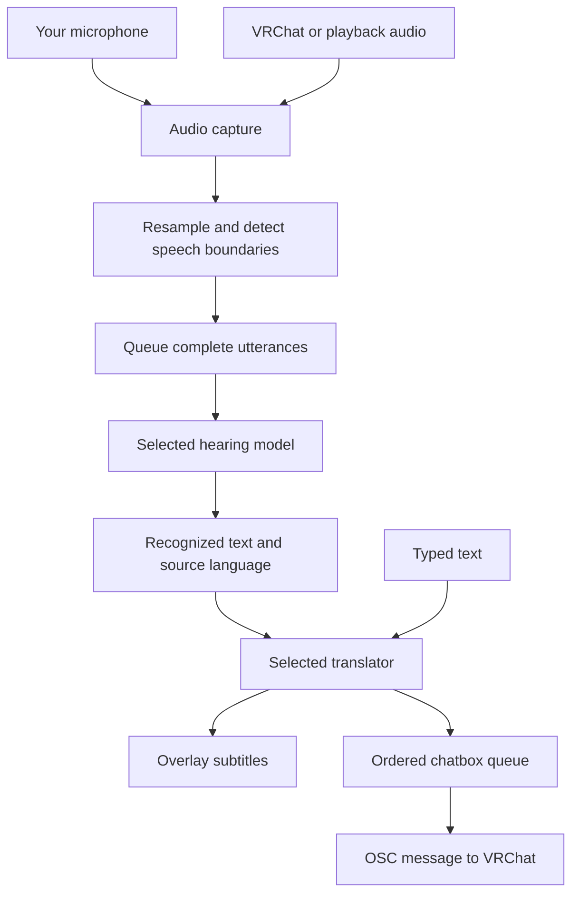

# ART — Project Structure and User Guide

ART means **Asia realtime Translator**. It is one Windows desktop application for hearing speech, translating it, displaying subtitles and sending text to VRChat's chatbox.

Since 0.12.11, online translation handles two destinations at once per utterance and shows each completed subtitle immediately. Panel destinations run before chatbox-only destinations. Local model CPU limits and recognition settings are unchanged. The chatbox still waits for one complete message. See [[LATENCY_REPORT]] for the measured two-language improvement and its limits.

For wrong wording, compare the original transcript with what was spoken first. Wrong original text points to audio/recognition; a correct original with a wrong translation points to the translation model or context. Lower latency does not automatically mean lower accuracy: this update removes waiting between independent requests without shortening speech capture or changing decoding.

Since 0.12.9, translation uses only the selected service and its explicitly configured models. Legacy add-on files are ignored for both Local Model and custom domains; a failure shows the selected service's error. Hearing and translation are separate selections; choose Local Model for both to run both steps locally.

> [!tip] Open this in Obsidian
> Copy this `.md` file into your Obsidian vault. Its headings, tables and diagrams work without extra plugins. The note is readable on its own. Links such as [[CODEBASE]] open the companion notes if you also put the repository's Markdown files in your vault.

## 1. What the application does

| Input | What ART does | Where the result goes |
| --- | --- | --- |
| Your microphone | Recognizes your speech, then translates it | Overlay and VRChat chatbox |
| VRChat audio or a chosen playback device | Recognizes other people's speech, then translates it | Overlay; optionally the chatbox with Add Speaker words |
| Text you type | Translates text without speech recognition | Overlay and chatbox |
| Music from a selected running app | Mixes audio into the configured physical microphone through the optional Windows mixer | The microphone selected in VRChat |

**Hearing** means speech → text. **Translating** means text → another language. They are separate jobs and can use different providers or local models. The optional music mixer is a separate audio feature, not a translator.

ART currently processes mixed audio; it does not identify individual people as Speaker 1 / Speaker 2. That feature is saved for later in [[ROADMAP]].

## 2. How speech moves through ART



1. Audio callbacks enqueue samples quickly so model work does not block recording.
2. Voice activity detection separates speech from silence and forms utterances.
3. The hearing worker turns an utterance into text plus a language code.
4. Translation workers produce the requested output languages. Local translation is serialized through a shared lock; adding targets can add waiting time.
5. Qt signals update the overlay. Completed translations can appear before every target finishes.
6. Chatbox output waits for the relevant results and follows its own ordering and pacing. Partial panel updates do not send partial chatbox messages.

Typed text enters at the translation stage. It does not need a hearing model.

### Important data objects

| Object | Meaning | Defined in |
| --- | --- | --- |
| `Heard` | Recognized text and detected language | `engine/stt.py` |
| `Utterance` | A message with an ID, original text, translations, destinations and status | `ui/backend.py` |
| `Settings` | Window, language, capture and provider preferences | `ui/config.py` |
| `ServiceChain` | Selected translator models followed by optional local add-ons | `engine/translators.py` |

Reusing an utterance ID updates its existing subtitle row. Destinations are captured when a message is queued, so changing languages affects subsequent messages rather than changing an older message midway.

## 3. What the language controls mean

| Control | Purpose | Example |
| --- | --- | --- |
| **I speak** | Up to three languages expected from your microphone | English + Vietnamese |
| **They speak** | Up to three languages expected from other people, or Auto | Chinese + Vietnamese |
| **Translated to** | Up to three languages displayed on the overlay | English + Chinese + Vietnamese |
| **Chatbox languages** in Settings → Translation | Follow They speak, or choose separate chatbox destinations | Chinese + Vietnamese |
| Typed **Send** language | Overrides chatbox destinations for that typed message | Japanese |

Choosing languages helps constrain recognition, but implementation differs by model. Multiple choices still require detection followed by filtering. SenseVoice uses automatic detection internally. Whisper's Chinese handling checks Mandarin/Cantonese before forcing a language. These controls do not retrain a model or guarantee correct recognition of every mixed-language sentence.

The chatbox can contain the microphone original plus translations, sharing **one 144-character budget**. Long messages are shortened to fit. Shared panel/chatbox targets reuse the same translation instead of calling the model twice.

## 4. Online services and local models

### Custom domain

Use Settings → Models to enter an API address and optional key, fetch its model list, and select models under Hearing and Translating. The `+` and `−` controls manage additional domains; each keeps its own configuration.

An **Online** connection result confirms the model-list/authentication check succeeded. It does not prove that a chosen model can transcribe audio or translate correctly. The server must support the corresponding API operation.

### Local model choices

| Model | Job | Languages and purpose | Hardware |
| --- | --- | --- | --- |
| Whisper large-v3-turbo | Hearing | English, Chinese, Cantonese, Vietnamese, Japanese and Korean; multilingual option | NVIDIA GPU |
| Whisper turbo · Vulkan (AMD) | Hearing | The same six app languages; separate Q5 model download (~547 MiB). Added in 0.12.10 | Vulkan-compatible GPU, including AMD |
| SenseVoice Small | Hearing | Chinese, Cantonese, English, Japanese and Korean; lightweight automatic detection, no Vietnamese | CPU |
| PhoWhisper Small | Hearing | Vietnamese specialist trained on diverse accents; use turbo for other languages or mixed conversations | CPU INT8 |
| NLLB-200 CT2 | Translation | All six app languages; default starting choice for low latency | CPU INT8 |
| Qwen3 1.7B INT8 | Translation | Alternative for the six app languages, thinking disabled; compare quality for your language pair | CPU INT8 |

These language lists describe the app's supported choices, not equal accuracy for every language or accent. PhoWhisper does not replace the multilingual choices. Small Qwen can still alter meaning, omit wording or produce less natural Cantonese.

For an AMD PC, open **Settings → Models → Hearing → Local Model → Set up**, then download **Whisper turbo · Vulkan (AMD)**. The runtime is bundled; install/update the graphics manufacturer's Vulkan-capable driver if needed. First loading can take tens of seconds. The NVIDIA option uses different model files. Vulkan has been tested on an RTX 3080; AMD performance still needs hardware verification. See [[native/whisper_vulkan/README]] for native build and validation details.

The non-turbo **Whisper large-v3** option was removed in 0.12.5. A saved old selection resolves to turbo; removing the option did not delete existing weights.

### Download, use and delete

- **Download** installs that model's pinned files. Completion activates the downloaded model for its job.
- **Use model** selects an installed model. Hearing and translating have separate selections.
- **Delete → Confirm delete** removes that model's app-managed weights and unfinished downloads. **Cancel** leaves them intact. Deletion is unavailable while any model download is active.
- A cleanup-only card appears for leftover non-turbo Whisper large-v3 files. It does not restore that model's Download/Use option.
- Shared NVIDIA libraries, other models, unknown files and settings are preserved. Model choices are not silently changed. Choose another model or download again when needed.
- Deletion frees disk files, not necessarily memory held by a loaded model. If Windows reports a file is in use, stop using the model or restart ART and try again. An error can leave some files already removed; retrying deletion is safe.
- The Delete button handles ART's own model folders. It does not remove external Hugging Face caches, Python packages or files downloaded by another application.

Downloads try Hugging Face first, then HF-Mirror after a connection failure or refused response. Resume and SHA-256 verification remain enabled. A successful local test does not establish availability from mainland China: the mirror redirected back to Hugging Face in an earlier probe.

## 5. Where files live

### User data — outside the source repository

| Location | Contents |
| --- | --- |
| `%APPDATA%\VRChat-Translator\ui.json` | Window, language, capture and chatbox preferences; last update notice shown |
| `%APPDATA%\VRChat-Translator\models.json` | API URLs/keys, model choices and fetched catalogs |
| `%APPDATA%\VRChat-Translator\addons\` | Legacy translation files (ignored since 0.12.9) |
| `%LOCALAPPDATA%\VRChat-Translator\local-model\` | App-managed local model files |
| `local-model\whisper\` | Whisper turbo weights |
| `local-model\sensevoice\` | SenseVoice weights |
| `local-model\phowhisper-small\` | PhoWhisper weights |
| `local-model\nllb\` | NLLB weights/tokenizer |
| `local-model\qwen3-1.7b\` | Qwen weights/tokenizer |
| `local-model\gpu\` | Shared NVIDIA libraries downloaded by ART |
| `local-model\downloading\` | Incomplete/resumable downloads; most models have a subfolder |
| `local-model\whisper.deleted` | Remembers explicit turbo deletion so its source-install cache fallback does not immediately fetch it again |

Model files are not embedded in the EXE. PhoWhisper downloads about 0.9 GiB and Qwen about 1.6 GiB; download size is different from RAM/VRAM use.

Do not copy `models.json` into a vault or repository you share: it contains API credentials. This guide contains no credentials.

### Source tree

```text
ART/
├── app.py                  Packaged entry point and self-check
├── ui/                     Windows, controls, settings and backend bridge
├── engine/                 Speech detection, recognition, translation and models
│   └── assets/             Bundled detector data and pinned model manifest
├── vrc/                    Capture, OSC, microphone mixer and shared translation helpers
├── assets/                 Icons and packaged assets
├── apo/                    Native microphone mixer implementation
├── driver/                 Earlier driver prototype, not the normal mixer path
├── tests/                  Unit and regression tests
├── tools/                  Build, source update, export and packaging helpers
├── bench/                  Development benchmarks and recordings; excluded from release export
├── updates/                Development update infrastructure; excluded from release export
├── .tools/                 Ignored probes, staged releases, logs and test downloads
├── .venv-app/              Development Python environment
├── build/                  Generated build files
├── dist/<version>/         Preserved release artifacts
└── *.md                    Guides, change log, measurements and handoff notes
```

## 6. Which code owns each feature

| Area | Main files | Responsibility |
| --- | --- | --- |
| Startup | `app.py`, `ui/main.py` | Apply pending EXE update, create backend/window, start checks |
| Overlay | `ui/main_window.py`, `ui/overlay_backdrop.py` | Position, opacity, click-through, resize, update notice |
| Settings and model cards | `ui/settings_window.py`, `ui/widgets.py` | Embedded setup, model selection, download/delete controls |
| Message display | `ui/log_view.py` | Original/translated rows and selection/copy |
| Interface languages | `ui/i18n.py` | English keys with Chinese and Vietnamese translations |
| Backend bridge | `ui/backend.py`, `ui/live_backend.py` | Signals, capture lifecycle, typed worker and chatbox scheduling |
| Audio capture | `vrc/audio.py` | Microphone/output/process audio sources |
| Speech boundaries | `engine/vad.py` | Resampling, voice detection and segmentation |
| Recognition | `engine/stt.py`, `engine/local_inference.py` | Cloud hearing, Whisper/PhoWhisper and SenseVoice |
| Speech scheduling | `engine/speech.py` | Hearing/translation queues and microphone ordering |
| Local translation | `engine/local_inference.py` | NLLB and Qwen, shared lock and weight lifetime |
| Online translation | `engine/translators.py`, `vrc/translate.py` | API requests, prompts, fallback and target reuse |
| Provider settings | `engine/services.py` | Domains, credentials, model catalogs and errors |
| API health | `ui/service_health.py` | Background connection checks with stale-result protection |
| Download/delete | `engine/local_model.py`, `ui/local_download.py` | Pinned files, resume, fallback, checksums and scoped deletion |
| OSC | `vrc/chatbox.py` | Message encoding/limits and VRChat window detection |
| Music mixing | `ui/music_dialog.py`, `vrc/apo_*.py`, `apo/` | Setup, selected-app capture, transport and native mixer |
| Updates | `ui/updater.py`, `tools/update.py` | Packaged GitHub update and separate source-checkout update |

The hearing adapter exposes `load()` and `transcribe(...) → Heard`. A translator exposes `prepare()` and `translate(...) → str`. Failures use `SttError` or `TranslateError` so the rest of the app can report/retry/fall back consistently.

NLLB and Qwen share one translation lock and release the other translator's weights before loading. This avoids keeping both large translators resident after switching. NLLB splits punctuated sentences into a batch and retries excessive repetition once. Qwen uses the non-thinking chat prefix and rejects truncated, repetitive, empty or obviously wrong-script output; those checks cannot prove meaning is correct.

## 7. Latency: what the numbers mean

Total delay includes **speech duration + sentence-end detection + queueing + recognition + translation + display/chatbox pacing**. Improving one stage does not automatically improve every other stage.

In the 23 October replay of six short EN/ZH/VI inputs, warm local medians were **294 ms for NLLB** and **2,218 ms for Qwen3 1.7B**. First calls including load were about 2.1 and 4.4 seconds. VRChat was running, but game workload was not controlled. These are component timings from a small sample, not guaranteed end-to-end delays.

PhoWhisper matched two Vietnamese reference recordings, with forced-language runs around 2.1–2.4 seconds. It is a Vietnamese CPU alternative, not a demonstrated speed improvement over GPU turbo.

The priority is **low latency while preserving meaning**. NLLB remains the default. See [[LATENCY_REPORT]] for methodology and [[LOCAL_TRANSLATION_PLAN]] for model choices, pinned sources and quality limits.

## 8. Development, testing and release

The working checkout is `F:\Code\vrchat-translator_9.10_gemini`. Reviewed source is exported into `F:\Code\vrchat-translator-public`, whose `main` branch belongs to [the GitHub repository](https://github.com/SentoMinh/ART-Asia-realtime-Translator). These are development/release checkouts for the same app. Keep their Git histories separate.

### Useful commands

Run from the working checkout:

```powershell
# Unit/regression tests; their fixture isolates Windows profile data.
.venv-app\Scripts\python.exe -m pytest -q

# Start the source app; this starts the actual application, not a preview.
.venv-app\Scripts\python.exe -m ui.main

# Build with the validated native mixer binaries.
powershell -File tools\build.ps1 -MixerBuild .tools\apo-prototype-10
```

Use isolated `APPDATA` and `LOCALAPPDATA` paths for probes so they do not change real settings or keys. Demo previews must close automatically. Do not use live microphone capture or OSC delivery merely to test layout.

### Release sequence

1. Make the change; update the version, translated update notice and documentation.
2. Run focused regression checks, then the full suite before packaging.
3. Commit the implementation. Export only committed, scanned source to the release checkout and an isolated build stage.
4. Build with the production `VrctMicApo.dll` and `VrctApoProducer.dll`; never bundle test DLLs, credentials, recordings or model weights.
5. Verify the EXE self-check, required runtimes, native DLLs, model manifest, source match, ZIP and hashes.
6. Upload a draft release against the exact source commit; compare uploaded asset sizes and digests before publishing.
7. Test real GitHub download, replacement/restart, new-version self-check and the no-update result.
8. Record the published commit, hashes and validation in [[AGENT_HANDOFF]]. Preserve older release artifacts.

Do not run `tools/export_public.py`'s main routine against a populated checkout: it deletes destination files outside the export, including ignored artifacts. Use its file-selection/scanning helpers with a reviewed copy operation that preserves unrelated files.

Source edits do not update an already-built EXE. A release tag identifies the built source; later documentation commits do not alter that binary. See [[AGENT_HANDOFF]] for the current published version and evidence rather than assuming the newest working file is already shipped.

## 9. Where to start when something breaks

| Symptom | First place to inspect |
| --- | --- |
| Speech is cut off or recognition is late | `engine/vad.py`, `engine/speech.py`; distinguish end-of-sentence delay from inference |
| Hearing uses the wrong language | Selected hearing model, I speak/They speak, `engine/stt.py` |
| A model appears downloaded but will not load | Its pinned files, runtime version and `local_model.missing()` |
| Model deletion fails | File-in-use error or redirected folder; stop using the model and retry; never broaden deletion to the whole cache |
| Translation repeats or loses a sentence | `engine/local_inference.py` / remote server, then replay the original input |
| Language selection changes but translation stays on the old model | `services.translate_models()`, `ServiceChain` cache key and saved role |
| Overlay languages differ from chatbox languages | Translated to versus Chatbox languages and typed Send override |
| One panel result arrives but chatbox waits | Remaining targets and ordered chatbox queue; partial display is intentional |
| Background disappears near 30% opacity | `ui/overlay_backdrop.py` geometry/lifetime and `MainWindow` painting |
| Music installation says a mixer already exists | Existing microphone attachment and rollback journal; see [[MUSIC_SETUP]] |
| Auto-update fails | GitHub release metadata/assets, `.new` update file, source version and `ui/updater.py` |

## 10. Companion notes and outstanding work

- [[README]] — user setup and controls.
- [[AGENT_HANDOFF]] — current release/source state and continuation instructions.
- [[CODEBASE]] — detailed implementation map and historical validation.
- [[CHANGELOG]] — reasons for changes and repair pointers.
- [[LATENCY_REPORT]] — measured timing and limits.
- [[LOCAL_TRANSLATION_PLAN]] — translation priorities, models, sources and evaluation.
- [[MUSIC_SETUP]] — optional microphone-mixer setup.
- [[ROADMAP]] — current focus and deferred speaker identification.

Outstanding checks include mainland-China downloads, broad accent/mixed-language accuracy, translation meaning across all six languages, controlled VRChat contention, Windows 10 behavior and fresh-PC installation. Keep those separate from unit-test or single-machine inference success.

## Voice detector adjustment (0.12.8)

Higher strictness rejects more uncertain sound; it can also miss quiet words. Settings → Sound → Restore detector defaults turns detection on and restores microphone 50% / other players 70%, preserving selected models and devices. Changes apply between sentences. See [[VOICE_DETECTION]] for the comparison with 0.12.2, recorded-audio checks and remaining limits.
