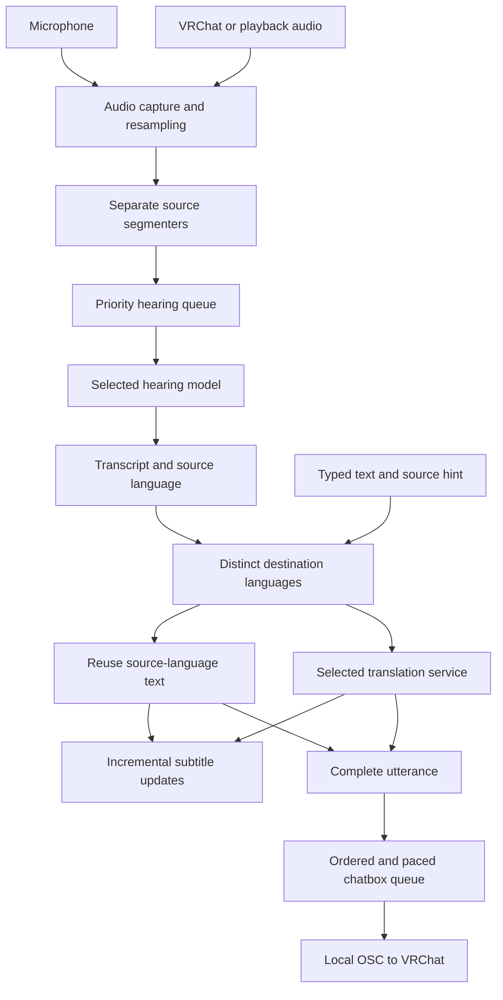

# ART — Complete Project Guide

ART means **Asia realtime Translator**. It is a Windows desktop companion for recognizing speech, translating it, showing subtitles and sending text to VRChat's chatbox. An optional microphone mixer adds music from another application to the physical microphone.

This note describes the source and release evidence available on **25 October 2026**, with the **0.12.12 source follow-up** to the verified 0.12.11 release. It brings together the product behavior, architecture, setup, models, costs, performance, development workflow and outstanding work.

> [!tip] Use this note in Obsidian
> Copy this Markdown file into your vault. It is readable on its own; headings, tables, callouts and Mermaid diagrams use Obsidian's built-in support. Copy the repository's companion Markdown files too if you want links such as [[CODEBASE]] to open locally. Source paths below are relative to the project root.

> [!info] Current state
> Version 0.12.11 is published. Online translation can run two target languages concurrently per utterance and show each subtitle as it finishes. A target shared by the panel and chatbox is translated once. Local translation remains serialized. The complete chatbox message still follows its own queue and pacing.

The 0.12.12 source also loads installed local translator weights on the background worker at startup and translates mixed CJK text instead of skipping it when an English/Vietnamese output matches the detected label. Completed mixed-text translations remain visible. The Voice detector restore-defaults card is removed from Settings → Sound; saved thresholds remain unchanged. Package evidence will be recorded after validation.

> [!warning] Evidence boundaries
> Passing tests and package checks establish the behaviors tested. They do not establish accuracy for every language, compatibility with every microphone or GPU, access from China, or the effect on VRChat frame rate. Open defects and missing checks are recorded below.

## Contents

- [[#Product and intended behavior]]
- [[#Setup and everyday use]]
- [[#Languages, panel and chatbox]]
- [[#Architecture and data flow]]
- [[#Hearing and translation models]]
- [[#Requests, tokens and cost]]
- [[#Voice detection and audio]]
- [[#Optional music mixer]]
- [[#Settings, files and privacy]]
- [[#Measured performance]]
- [[#Troubleshooting and accuracy]]
- [[#Source map and development]]
- [[#Build, release and updates]]
- [[#Known defects and next work]]
- [[#Decisions and version history]]
- [[#Companion notes and maintenance]]

## Product and intended behavior

| Input | Processing | Output |
| --- | --- | --- |
| Your microphone | Speech recognition, then translation | Overlay and VRChat chatbox |
| VRChat audio or a chosen playback device | Speech recognition, then translation | Overlay; optionally your chatbox |
| Typed text | Translation without speech recognition | Overlay and chatbox |
| Music from a selected running application | Optional native audio mixing | The configured physical microphone |

**Hearing** means speech → text. **Translating** means text → another language. They are selected separately and may use different models or services.

The product is one application with configurable Local Model and custom services. Existing model and device choices should be preserved across ordinary updates and unrelated setting changes.

The interface is a desktop overlay intended for desktop, windowed or borderless VRChat use. It can stay on top, be moved to the VRChat window and be resized. This is not a dedicated headset overlay. Mixed incoming audio is processed as a shared stream; ART does not currently identify individuals as Speaker 1 / Speaker 2.

The priorities are intelligible, complete translations, dependable microphone and game capture, short waits and explicit control over the service doing inference. Speaker identification is deferred in [[ROADMAP]].

## Setup and everyday use

### Packaged application

1. Get the Windows EXE or ZIP from the [public releases](https://github.com/SentoMinh/ART-Asia-realtime-Translator/releases). Extract the ZIP before running the program.
2. Start `VRChat-Translator-0.12.11.exe`. The one-file package unpacks its runtime on launch, so startup can take a few seconds. Python is included; users do not install Python or a development environment.
3. Select the microphone and incoming audio source using the device controls. Enable the microphone and speaker controls that you want to use, and check their level meters.
4. In Settings, configure **Hearing** and **Translating** separately. For local inference, download the chosen models. For a custom service, enter its base URL, API key if required and model choices, then use Connect.
5. Set **I speak**, **They speak**, **Translated to** and the chatbox languages.
6. In VRChat, enable OSC through the action menu's OSC controls. ART sends OSC to `127.0.0.1:9000`.
7. Try a short spoken sentence and a typed message. Check the original transcript, panel translation and chatbox independently.

The Windows target is 64-bit Windows 10 version 1809 or later and Windows 11. Windows 10 and fresh-PC coverage remain incomplete. The selected-application music path requires Windows 11. On Windows 10, the game-audio fallback may capture system playback and include other applications.

The release includes `install_windows.bat` for Windows runtime setup and `READ-ME-FIRST.txt` for startup help. The installer's `--check` checks platform prerequisites; its microphone-permission reminder is not a live permission test. The application is unsigned, so Windows may display a reputation warning.

### Interface details

- Header controls enable microphone and speaker processing; adjacent device controls select their sources. Meters show arriving audio.
- The wave control toggles voice detection. The globe selects the interface language. Pin controls always-on-top behavior.
- The move-to-VRChat control positions the overlay with the game. The window supports top-edge/corner resizing and a bottom-right size grip.
- At low backdrop opacity, below 30%, empty areas can pass clicks through to the game. The backdrop is a separate window; interactive controls and subtitle text remain usable.
- Clicking original text copies it. Dragging over text supports selection and copying, with Ctrl+C support.
- Model setup and downloads are embedded in Settings. Closing a setup panel does not cancel an active download.
- A release notice is recorded per application version in user settings.

## Languages, panel and chatbox

### Language controls

| Control | Meaning |
| --- | --- |
| I speak | Up to three expected microphone languages |
| They speak | Up to three expected incoming languages, or automatic detection |
| Translated to | Up to three subtitle-panel destination languages |
| Chatbox languages | Follows all selected They speak languages by default, or a custom set of up to three |
| Typed Send language | An explicit single target can override the default for typed messages |

Supported application language codes are `en` English, `zh` Mandarin Chinese, `yue` Cantonese, `vi` Vietnamese, `ja` Japanese and `ko` Korean. Model support differs; see the model table. Interface translations currently cover English, Chinese and Vietnamese.

When chatbox targets follow an automatic They speak setting, ART uses the last supported language heard, with English as the fallback. Typed text uses the first I speak language as its source hint.

A speech line captures its output-language choices when the translation job is created after recognition. Later settings changes do not rewrite that line's captured destinations.

### Sharing translations

ART forms an ordered union of the panel and chatbox destinations. It translates each distinct destination once per utterance. A destination matching the recognized or configured source language normally reuses the original text immediately. Since 0.12.12, CJK text inside an English/Vietnamese output still reaches translation; this avoids skipping mixed-language speech but may also translate text containing a foreign proper name. Other code-switching pairs remain outside this script check.

For example, with English input, Vietnamese on the panel and Vietnamese in the chatbox, ART makes one Vietnamese translation and uses it in both places. Adding Japanese only to the chatbox adds a separate Japanese translation.

Panel destinations are queued first. Since 0.12.11, an online translator can process two pending destinations concurrently. Partial subtitle updates use the same utterance ID, so completed languages update a row rather than creating duplicate rows. The final results retain the selected language order even if requests finish in a different order.

### Chatbox behavior

- Microphone output combines the original and the available requested translations into one message.
- **Add my own words** controls original-text inclusion for typed output. Microphone output already includes its original.
- **Add Speaker words** is off by default. When enabled, incoming speech can be sent to your own chatbox using the first panel target with the original. It is independent of typed-message settings; disabling it clears queued speaker messages.
- One failed translation does not discard successful destinations. If the requested chatbox translations fail, ART can send the original with the failure shown on the app's row.
- Output is deduplicated and shortened to fit the app's **144-character** message budget. Multiple translations share that budget; it is not 144 characters per language.
- The app enforces a minimum **1.5 seconds** between chatbox messages. These numbers describe this source version's implementation.
- Partial panel results do not send partial chatbox messages. Chatbox output waits for the completed translation job and its own queue.
- Microphone translation jobs run in their own single-worker lane to preserve microphone order. Typed messages use a separate worker.

OSC uses UDP. A “sent” state means ART issued the message; it is not an acknowledgment that VRChat displayed it. Turning on OSC, selecting the right source and checking the game remain separate troubleshooting steps.

## Architecture and data flow



### Modules and responsibilities

| File | Responsibility |
| --- | --- |
| `app.py` | Packaged entry point, including self-check handling |
| `ui/main.py` | Application startup, logging and window/backend wiring |
| `ui/main_window.py`, `ui/widgets.py` | Overlay controls and subtitle presentation |
| `ui/backend.py` | Backend signals, language definitions and utterance data structures |
| `ui/config.py` | Settings data structure and persistence |
| `ui/live_backend.py` | Audio lifecycle, typed jobs, status and chatbox queue |
| `vrc/audio.py` | Microphone and game/playback capture |
| `engine/vad.py` | Resampling, speech detection and sentence boundaries |
| `engine/speech.py` | Capture-to-recognition pipeline and speech translation jobs |
| `engine/stt.py` | Online hearing adapters and `Heard` results |
| `engine/local_inference.py` | Local hearing/translation loading and inference |
| `engine/whisper_vulkan.py` | Python interface to the native Vulkan hearing runtime |
| `engine/translators.py` | Selected-service translation, model fallback and cooldowns |
| `engine/services.py` | Provider/domain configuration and model discovery |
| `vrc/translate.py` | Translation prompt, destination reuse and concurrent target scheduling |
| `vrc/chatbox.py` | Message fitting, OSC, typing indicators and VRChat detection |
| `ui/service_health.py` | Configuration/connection health checks |
| `engine/local_model.py`, `ui/local_download.py` | Local model manifest, downloads, deletion and UI |
| `ui/updater.py`, `tools/update.py` | Packaged and source update paths |

`Heard` carries recognized text and language. `Utterance` carries a line's identity, original, destinations, translations and state. Partial updates copy the available results so that later worker mutations do not change an already emitted snapshot.

`ServiceChain` means the **selected translation service and its configured models**. Since 0.12.9, it does not append legacy add-on services or automatically route translation to another domain.

### Threads and concurrency

Audio callbacks enqueue samples quickly. A cutting thread resamples and segments them; one hearing thread recognizes sentences, giving queued microphone sentences priority over queued speaker sentences. Priority does not interrupt an inference already running.

Speech finishing has two speaker workers and one microphone worker. Typed translation has a separate worker. In 0.12.11, each active online job can create at most two target requests at once. With all four job slots busy, the default arrangement can therefore reach **eight concurrent target requests** across utterances. This is an implementation ceiling for these workers, not a global service rate limiter.

Local translation remains serialized by a shared model lock. NLLB and Qwen cannot infer concurrently through that path, and switching between them unloads the previous translation model. The local CPU configuration remains INT8, one inter-thread worker and two intra-thread workers.

The online change adds locks around lazy HTTP-client creation, chain creation and cooldown state. A concurrent success cannot erase a failure cooldown recorded by another request. The change preserves prompts, recognition settings, model selection and decoding.

Queues are not globally bounded, and stale-speaker handling is incomplete. See [[#Known defects and next work]] before treating this as an overload-safe pipeline.

## Hearing and translation models

### Local choices

| Model ID / choice | Job | Runtime and hardware | Scope and limitations |
| --- | --- | --- | --- |
| `large-v3-turbo` | Hearing | faster-whisper; NVIDIA CUDA | Multilingual option for the six app languages; requires its model and CUDA libraries |
| `whisper-turbo-vulkan` | Hearing | whisper.cpp; compatible Vulkan GPU and driver | Separate Q5_0 turbo model, about 547 MiB; designed to include AMD, but the recorded hardware test used an RTX 3080 |
| `sensevoice` | Hearing | sherpa-onnx on CPU | English, Mandarin, Cantonese, Japanese and Korean; no Vietnamese |
| `phowhisper-small` | Hearing | faster-whisper / CTranslate2 CPU INT8 | Vietnamese specialist; about 0.9 GiB download; compare latency on the intended audio and hardware |
| `nllb-200-ct2` | Translation | CTranslate2 CPU INT8 | Default local translator; supports the six app languages |
| `qwen3-1.7b-ct2` | Translation | CTranslate2 CPU INT8 | Optional non-thinking translator; about 1.6 GiB; supports the six app languages but needs broader quality evaluation |

Hearing and translating keep separate selections. Switching a local hearing model releases the previous engine where supported. Switching between local translators releases the previous weights before loading the next.

SenseVoice detects its supported languages internally rather than following a forced-language hint. The shared speech pipeline filters the recognized result against the configured language choices. Selecting several languages does not split overlapping speakers or guarantee correct code-switching.

Non-turbo Whisper large-v3 was removed from the selectable list in 0.12.5. A saved old selection falls back to turbo. Existing old weights are retained until explicitly deleted.

### Local translator behavior

**NLLB** splits suitable multi-sentence text conservatively, translates the sentences as a batch and joins the results. It uses greedy decoding with beam size 1. Repetition checks can trigger one bounded retry of the affected sentence with a four-token no-repeat constraint. Empty or incomplete results are reported as errors.

**Qwen3 1.7B** uses the translation-only prompt and a non-thinking assistant prefix. The implementation uses greedy decoding, a 1,024-token input limit and up to 512 generated tokens. It rejects missing end-of-sequence, empty or reasoning output, runaway repetition and obvious wrong-script output. These checks cannot prove that a fluent translation preserves the meaning.

NLLB remains the local default because the recorded replay was substantially faster. Qwen is an alternative to evaluate, not an established quality upgrade. A tested Qwen 0.6B conversion copied source text or changed meaning and was not offered. Hy-MT and other candidates in [[LOCAL_TRANSLATION_PLAN]] remain proposals unless separately implemented.

### Vulkan implementation

The bridge uses whisper.cpp **v1.9.2**, pinned to revision `306c88f4d1286aec1bf96e544632897886af5501`. The bridge, ggml and Whisper are statically linked into `art_whisper_vulkan.dll`; Windows supplies the graphics driver's Vulkan loader.

The runtime needs a compatible GPU/driver. The Vulkan SDK is needed for development builds, not for packaged-app users. A persistent native context is warmed when loading and reused between sentences. Input audio stays in memory. The Q5_0 model has its own cache; selecting it does not convert or replace the NVIDIA model.

The Python wrapper and native ABI must stay synchronized. See [[native/whisper_vulkan/README]] for the pinned source, build requirements and hardware evidence. Model-close support exists, but the backend shutdown-wiring issue below still needs attention.

### Custom services and discovery

The UI exposes Local Model and configurable custom domains. Each domain has a display name, API base URL, optional key and separate hearing/translation model choices. Additional domain rows can be added or removed. Older named-provider adapters remain in the code for existing configurations.

- Standard custom hearing uses a Whisper-style `/audio/transcriptions` endpoint.
- Existing provider adapters also support audio-chat request styles where configured.
- General text translation uses `/chat/completions`.
- The exact custom model ID `nllb-200-ct2` selects the direct `/translate` adapter with explicit source and destination languages.
- Model discovery tries `/models`; on HTTP 404 it may try `/v1/models`.
- Cached model lists are tied to the domain configuration so stale credentials/URLs do not silently reuse a previous connection's catalog.
- Connect and startup health checks have a bounded deadline, up to 30 seconds. Listing models or accepting credentials does not prove that a selected inference request will succeed.

A discovered `/v1/models` endpoint does not currently correct the saved inference base URL. If the service requires `/v1`, include it in the configured base yourself. This is an open defect, not a reason to assume every successful Connect means translation will work.

### Failure boundaries

Comma-separated translation model choices are tried within the selected service. Failure cooldowns avoid repeatedly hitting an unavailable model: the current code uses approximately 60 seconds for ordinary failures and 600 seconds for detected limit failures, with a server retry interval used where supported.

Since 0.12.9, translation ignores legacy add-on configuration files for both Local Model and custom domains. It reports failure from the chosen service instead of silently using another domain.

Hearing is a separate path. An online hearing failure can attempt local hearing and request a service switch. Do not generalize the translation-service boundary into a promise that hearing never falls back.

### Downloads and deletion

The local-model manifest pins download files, revisions, expected sizes and SHA-256 hashes. Downloads support resume, enforce size/bounds checks and verify available disk space and completed files.

For supported Hugging Face downloads, connection failures or interrupted transfers can fall back to HF-Mirror. Other hosts do not receive this substitution. A tested mirror request redirected back to Hugging Face; that check does not establish mainland-China access.

A completed download activates that model for its role. An installed model also has a Use model action. Downloads continue when the setup panel is closed.

Delete uses an explicit confirmation and removes only the selected model's managed files and partial downloads. It preserves other models, shared GPU libraries, unknown files, external caches and settings. Deletion is unavailable while a download is active. It does not silently choose another service. Locked files can leave a partial removal that needs retrying; deleting files is separate from unloading an in-memory engine.

The `whisper.deleted` marker prevents a deliberately removed CUDA model from being silently fetched again by the source fallback path. A retained old large-v3 cache can be cleaned up separately.

An optional offline NLLB package is documented in [[README]]. It is a transfer/install fallback when normal downloads are unavailable; it does not change the preferred model-download path.

## Requests, tokens and cost

**Showing the same translated text in the subtitle panel and VRChat chatbox does not require a second translation request.** The reuse is within one utterance. It is not a persistent cache of every sentence previously translated.

For English input, with a functioning online translator and no retries:

| Panel destinations | Chatbox destinations | Distinct new translations |
| --- | --- | --- |
| Vietnamese | Vietnamese | 1 |
| Vietnamese | Japanese | 2 |
| Vietnamese, Japanese | Japanese | 2 |
| English | English | 0 — the original is reused |
| Vietnamese | English, Vietnamese | 1 |
| Vietnamese, Japanese | Chinese, Korean | 4 |

The examples count translation requests, not speech-recognition requests. Hearing can still run even when no translation is needed. A speaker line follows its configured speaker-chatbox behavior rather than every microphone chatbox preference.

For a token-billed chat API, each destination request contains its translation instruction, the source text and the generated answer. More distinct destinations generally mean more billable input/output. Longer text, longer output and fallback attempts can increase usage. The provider determines whether and how it charges failed requests, cached tokens or audio.

The two-target concurrency added in 0.12.11 changes when the requests run. It does not add a second request for a shared destination or inherently reduce the number of tokens. Concurrent traffic can hit a service's limits sooner under load, so actual usage can still differ if failures or retries occur.

Sending OSC and drawing the panel use no model API tokens. With local hearing and local translation, inference incurs no external model API token charge; it uses local CPU/GPU, memory, disk and electricity. Online hearing may have separate audio billing. No provider price or account balance is recorded in this note.

## Voice detection and audio

Incoming game audio is normally captured at 48 kHz and converted to mono. Microphone capture uses the selected device's supported input rate. The segmenter resamples through soxr to 16 kHz mono for detection and hearing.

Silero VAD v6 runs locally with ONNX Runtime on the CPU. It processes 512-sample frames, or 32 ms at 16 kHz, and keeps 64 samples of context between frames. Microphone and speaker input have independent segmenters.

| Setting | Current value | Purpose |
| --- | --- | --- |
| Microphone threshold | 0.50 | Default speech detection for the microphone |
| Speaker threshold | 0.70 | Stricter rejection for game audio and music |
| Pre-roll | 0.3 seconds | Retains sounds immediately before detection |
| End-of-sentence silence | 0.8 seconds | Waits through short breaths before completing a sentence |
| Retained trailing silence | 0.2 seconds | Keeps a short tail in the submitted segment |
| Minimum counted speech | 0.25 seconds | Rejects very short events |
| Maximum segment duration | 12 seconds | Forces a cut during very long speech |
| Continuation hysteresis | 0.15 below the start threshold | Avoids repeatedly stopping at small probability changes |
| Detector-off chunk duration | 4 seconds | Clock-based fallback |
| Detector-off quiet RMS | 0.003 | Skips sufficiently quiet chunks |

The 0.8-second silence interval is intentional: an earlier 0.55-second value cut sentences at breaths. Lowering it reduces waiting but can reduce completeness.

Since 0.12.8, a sentence holds the threshold it started with. Moving the slider takes effect on the next sentence rather than changing the current boundary midway. Toggling VAD drops the pending segment. Ordinary source mute/stop does not yet provide equivalent resetting; that is a recorded bug.

To compare the defaults, enable Voice detector in Settings → Translation and set the Sound sliders to microphone 50% / other players 70%. The separate restore-defaults card has been removed from the current source UI; existing saved values remain until changed.

The shared speech layer also suppresses known hallucination patterns, filters unsupported languages and applies a short repeated-line guard. Unsupported-language announcements are throttled. These are heuristics; they can neither perfectly reject noise nor replace recognition-quality evaluation.

The VAD replay in [[VOICE_DETECTION]] covered 494 clips at four fixed thresholds, or 1,976 comparisons. Fixed-threshold segment lengths and cuts matched the 0.12.2 baseline. That establishes a segmentation regression check, not translation accuracy. In the recorded default-threshold noise subset, 2 of 14 clips were admitted at 0.50 and 1 of 14 at 0.70. A proposed change to count lower-probability continuation as enough speech was rejected because it admitted more noise.

## Optional music mixer

The music feature uses a Windows microphone Audio Processing Object, or APO. It adds audio to an attached **physical microphone** rather than creating a virtual cable or a separate virtual microphone. The earlier kernel-driver prototype under `driver/` is retained for reference and is not the current production path.

### Using it

1. Open Music and select a running source application. Reload the source list if the application was opened afterward.
2. Select the microphone that the mixer is attached to, and select the same microphone in VRChat.
3. If setup is missing, Install offers the native setup helper and Windows administrator consent. Installation can briefly restart Windows audio.
4. Start playback in the source application, then press Play in ART and adjust music volume.
5. Stop ends playback. Closing only the Music panel leaves it running; closing the whole application stops it.

The current dialog offers selected-application audio on Windows 11. WAV playback exists in developer tools, not as a source choice in the production dialog.

The source meter shows audio before the volume control. It does not prove the receiving application actually processed the microphone effect. Music reaches applications using that microphone, potentially including ART's own hearing path. Browser capture includes the browser process tree rather than one selected tab. VRChat mute and push-to-talk still apply independently.

### Attachment and recovery

The mixer attaches to one microphone at a time. If it is already attached elsewhere, **Use [microphone]** selects the existing attached device in ART; it does not move or reinstall the effect.

Moving the effect requires removing the previous attachment using its saved rollback journal before installation on the new microphone. Setup validates the native files and endpoint and records affected registry values before changing them. Avoid manually deleting registration values.

The attachment journal is:

```text
%PROGRAMDATA%/VRChat-Translator/MicrophoneMixer/attachment.json
```

`apo/remove_mixer.bat` requests administrator approval and restores recorded registry values. It restarts Windows audio and retains the journal and DLLs for diagnostics. Reopen applications whose capture stopped after an audio restart.

Native self-tests and live callback checks do not prove VRChat or another application receives the processed stream. Fresh-PC installation, Windows 10 live behavior, microphone hotplug, physical mute, other driver combinations and signed distribution still need validation. See [[MUSIC_SETUP]] and [[apo/README]].

## Settings, files and privacy

### User data

| Location | Contents |
| --- | --- |
| `%APPDATA%/VRChat-Translator/ui.json` | UI, languages, device choices, preferences and version notice state |
| `%APPDATA%/VRChat-Translator/models.json` | Service URLs, API keys, model selections and domain configuration |
| Legacy add-on files | Retained old configuration; ignored by current translation routing |
| `%LOCALAPPDATA%/VRChat-Translator/engine.log` | Runtime errors, capture information, transcripts, translations and timing |
| `%LOCALAPPDATA%/VRChat-Translator/engine.log.1` | Previous rotated log |
| `%LOCALAPPDATA%/VRChat-Translator/update.log` | Source-launcher update history |
| `%LOCALAPPDATA%/VRChat-Translator/selfcheck.txt` | Packaged self-check results |
| `%LOCALAPPDATA%/VRChat-Translator/local-model/` | Downloaded local model weights and supporting libraries |
| ProgramData attachment journal above | Native microphone-effect setup and rollback state |

The engine log rotates at approximately 1,000,000 bytes with one backup. Packaged-updater events use the engine log; the separate `update.log` belongs to the source updater.

API keys are stored in the user's configuration file as plaintext; ART does not provide application-level encryption for that JSON. The model file, logs and recordings are not suitable for a public repository or a shared Obsidian vault without review/redaction.

### Local model folders

Under the local-model directory:

```text
local-model/
  whisper/            NVIDIA Whisper turbo
  whisper-vulkan/     Separate whisper.cpp Q5_0 turbo model
  sensevoice/         SenseVoice Small
  phowhisper-small/   Vietnamese hearing model
  nllb/               NLLB translation model
  qwen3-1.7b/         Qwen translation model
  gpu/                Shared CUDA libraries
  downloading/        Resumable partial downloads
  whisper.deleted     Explicit CUDA-model deletion marker
  whisper-v3/         Possible retained cache of the removed model
```

Not every folder exists on every installation. The packaged application includes inference runtimes and the VAD model, but the larger speech/translation weights are downloaded separately.

The updater can create temporary `.part`, `.new` and `.old` files beside the EXE while downloading or replacing it. These are application-update artifacts, not user model caches.

### Data movement

| Path | What leaves the local inference process |
| --- | --- |
| Online hearing | The captured speech segment is sent to the configured hearing service |
| Online translation | The recognized or typed text and translation request are sent to the selected service |
| Local hearing + local translation | Speech/text inference stays on the PC |
| OSC chatbox | The selected message is sent to local VRChat, which can display it to other users |
| Model downloads and updates | Network requests fetch model files, release metadata or application assets |
| Configured service health checks | Requests contact the configured service |

Local inference does not mean every application feature is network-free: model downloads, update checks and configured service checks can still access the network.

Normal speech processing keeps audio in memory rather than recording it to a file. Existing logs do contain conversation text. The 0.12.11 timing messages add durations, source labels and target codes without adding transcript text, keys or endpoint URLs to those timing lines.

This guide contains no credentials, personal endpoints, account emails, voice recordings or copied user settings.

## Measured performance

### Two online targets in 0.12.11

The production helper was compared with the prior sequential helper using the same selected custom service, HTTP transport and six synthetic phrases covering English, Chinese and Vietnamese. Each phrase had two destination languages, and execution order alternated between modes.

The endpoint advertised a Qwen model, but its actual weights, runtime, cache and hardware were not verified. No captured conversation was submitted for this comparison.

The first sequential pair took 4,140 ms, including a 4,043 ms first request. Initialization, connection setup and server waiting were not separated. Both modes for that first phrase were excluded from the warm comparison, leaving five paired phrases:

| Warm measure | Sequential | Two concurrent targets |
| --- | ---: | ---: |
| First complete subtitle, median | 90.5 ms | 93.2 ms |
| Both translations complete, median | 188.8 ms | 102.8 ms |
| Both complete, observed range | 175.5–196.7 ms | 94.4–115.8 ms |

Both-language completion took about **46% less time** in this small sample. First-result time was similar. All 24 requests succeeded, and all 12 paired target outputs matched across modes, including the first phrase.

This measures translation helper completion. It excludes capture, the sentence-end pause, recognition, worker queues, Qt presentation and OSC pacing. It does not establish general accuracy, end-to-end speed, lower game load or faster local inference. Network and remote load/cache conditions were uncontrolled.

Evidence: [[LATENCY_REPORT]], `.tools/latency-0.12.11/production.json` and its `measure.py`.

### Other recorded measurements

These are different experiments with different inputs and conditions; they are not one combined benchmark.

| Experiment | Observation | Practical limit |
| --- | --- | --- |
| Local NLLB vs local Qwen3 1.7B, six phrases over three rounds | Warm median about 294 ms vs 2,218 ms; first calls about 2,141 ms vs 4,358 ms | Twelve warm calls per model after excluding the first round; VRChat was running and background load was uncontrolled |
| PhoWhisper, two Vietnamese recordings | Load about 4,877 ms; forced-Vietnamese calls about 2,081–2,428 ms; Auto about 3,621–4,209 ms | Reference words matched apart from case on these clips; other accents and live conditions remain unverified |
| Vulkan Whisper on RTX 3080 | Load/warm-up about 20.4 seconds; later calls 403–1,625 ms for 3.3–4.32-second clips | Six forced/Auto calls across English, Chinese and Vietnamese; no AMD or game-FPS conclusion |
| Progressive-display test with fake 120 ms translators | First result about 361 → 120 ms; all three still complete at about 361 ms | Demonstrates earlier presentation, not faster inference |

The local Qwen comparison did not establish a quality improvement; some outputs omitted or changed meaning. A successful API response or nonempty model output is not evidence of semantic correctness.

Earlier local/remote comparisons and their runtime versions are retained in [[LATENCY_REPORT]]. Avoid combining medians from different runs into a claimed end-to-end time.

### Reading the timing log

- `hearing source=... wait_ms=... recognition_ms=...`: the wait includes the final silence interval and queue time. Recognition measures the hearing call and any fallback within that call.
- `translation target=... duration_ms=...`: one target's translation-call duration, including any model fallback or request retry inside the adapter.
- Per-line translation duration measures the finishing stage, not time spent waiting before that stage starts.
- Existing total speech latency is measured relative to the recorded speech end.

From the end of speech, the user can wait for sentence-end silence, hearing queues, recognition, translation queues, translation, UI delivery and chatbox pacing. Measuring from the beginning of speech also includes the duration of speaking.

Two concurrent translations address one part of that path. A slow hearing model, long queue, cold model load or chatbox pacing can still dominate the experience.

## Troubleshooting and accuracy

| Symptom | First checks |
| --- | --- |
| No microphone level | Selected device, microphone toggle, Windows microphone access and whether another app changed the device |
| No incoming level | VRChat running, speaker toggle, selected capture source and Windows capture-path support |
| Level moves but no sentence | Threshold, input volume, supported hearing languages, model readiness and actual pauses between words |
| Original transcript is wrong | Wrong source, overlapping voices/music, clipping, language selection, hearing model and segment boundaries |
| Original is correct but translation is wrong | Translator choice, source/destination direction, incomplete context, names and slang |
| Correct model list but translation returns 404 | Whether the configured base needs `/v1`; discovery does not currently repair it |
| First sentence is much slower | Model load/warm-up, HTTP connection setup or service waiting; compare later calls |
| Panel appears before chatbox | Expected partial results, remaining targets and the chatbox's 1.5-second pacing |
| Chatbox says sent but nothing appears | VRChat OSC, game state and display behavior; UDP has no delivery acknowledgment |
| Several languages are missing from chatbox | Captured target choices, per-target errors and the shared 144-character budget |
| Local choice still contacts a hearing service | Hearing and Translating are separate; select local for both jobs |
| Model download stalls | Disk space, partial-file state and network access; try the documented offline NLLB path if applicable |
| Music meter moves but others hear no music | Same attached microphone in ART and VRChat, receiving-app processing, VRChat mute/PTT and an audio restart |
| New speech includes words from before a mute | The source segment-reset defect recorded below |
| Old speaker lines appear much later | The missing translation-stage expiry and unbounded queues recorded below |

For an accuracy investigation, retain one short example with what was actually said, the displayed original, the translation, chosen languages and model names. That separates recognition errors from translation errors without relying on a vague impression.

The reported live accuracy problem is still unresolved: no specific failing utterance or audio example was supplied. The 0.12.11 change did not alter the hearing model, detector, prompt or decoding settings, and should not be described as an accuracy fix.

## Source map and development

### Repository layout

```text
app.py                      Packaged entry point
run_ui.bat                  Source launcher with optional Git update
requirements.txt            Python application and development dependencies
ui/                         PySide6 interface, state, downloads, update UI
engine/                     Hearing, VAD, translation and local model management
engine/assets/              VAD model and pinned local-model manifest
vrc/                        Capture, OSC, music and native setup adapters
assets/                     Icons and packaged native runtime assets
native/whisper_vulkan/      C++ Vulkan hearing bridge and CMake build
apo/                        Production microphone-mixer sources and validation tools
driver/                     Earlier kernel-driver prototype
tests/                      Unit and component regression checks
tools/                      Build, update, export and inspection helpers
bench/                      Development benchmark work; excluded from public export
updates/                    Local update infrastructure; excluded from public export
.tools/                     Ignored build staging, measurements and release evidence
.venv-app/                  Development Python environment
build/                      PyInstaller intermediates
dist/                       Application artifacts; preserve earlier releases
```

The development checkout is `vrchat-translator_9.10_gemini`, on the `music-mix` branch at the documented snapshot. The public checkout is the sibling `vrchat-translator-public`, on `main`. They have separate commit histories, so an implementation can have different development and public commit IDs.

### Runtime and dependencies

The source environment uses Python 3.12 and PySide6. Main dependencies include NumPy, proc-tap, sounddevice, PyAudioWPatch, soxr, ONNX Runtime, HTTPX, zhconv, faster-whisper, sherpa-onnx, CTranslate2 and tokenizers. Pytest and PyInstaller support development and packaging.

The current requirements use minimum versions rather than a fully pinned lockfile. A fresh installation can therefore differ from the tested environment. Record actual dependency/runtime versions when comparing performance or producing a release.

Production local inference does not require PyTorch or a separate local inference server. The build excludes heavyweight unused packages and selects bundled assets explicitly. CUDA libraries and large model weights are managed separately.

### Source commands

From the project root, for a new development environment:

```powershell
uv venv .venv-app --python 3.12
uv pip install --python .venv-app/Scripts/python.exe -r requirements.txt
```

Run the application directly, or show a UI demo:

```powershell
.venv-app/Scripts/python.exe -m ui.main
.venv-app/Scripts/python.exe -m ui.main --demo
```

A direct live launch can start configured capture and service activity. A demo uses example messages. Close development previews after checking them.

Run the application test suite:

```powershell
.venv-app/Scripts/python.exe -m pytest tests -q
```

Useful focused groups include:

| Area | Test files |
| --- | --- |
| Target reuse, concurrency and typed output | `tests/test_translation_targets.py`, `tests/test_typing.py` |
| Selected-service isolation | `tests/test_service_boundary.py` |
| Speech pipeline and audio choices | `tests/test_engine.py`, `tests/test_audio_selection.py` |
| Local inference and quality guards | `tests/test_local_translation_quality.py`, `tests/test_local_qwen.py`, `tests/test_whisper_vulkan.py` |
| Downloads, selection and removal | `tests/test_local_model.py`, `tests/test_local_choices.py`, `tests/test_local_delete.py` |
| Settings, domains and connection checks | `tests/test_ui.py`, `tests/test_domains.py`, `tests/test_service_health.py` |
| OSC and chatbox | `tests/test_chatbox.py` |
| Updates | `tests/test_update.py`, `tests/test_updater.py` |
| Music/APO | `tests/test_music_dialog.py`, `tests/test_apo_setup.py` and related `test_apo_*` files |

Tests isolate AppData through `tests/conftest.py`. Standalone diagnostics do not inherit that fixture: arrange their own temporary settings and prevent unintended capture, OSC or model-selection writes.

Use `tools/snapshot_ui.py` for UI snapshots. Keep benchmark adapters under `bench/` separate from production adapters; an experimental model or a successful benchmark is not automatically an integrated feature.

## Build, release and updates

### Native and application builds

The Vulkan bridge requires Visual Studio 2022 C++ tools, CMake and a Vulkan SDK. Its helper uses a short build directory, `.tools/wvk`, and two build jobs because shader-generation paths and build load can otherwise be problematic.

Example commands, replacing the SDK and native-mixer paths with existing validated builds:

```powershell
pwsh -File tools/build-whisper-vulkan.ps1 -VulkanSdk C:/VulkanSDK/<version>
pwsh -File tools/build.ps1 -MixerBuild <production-mixer-folder> -WhisperBuild assets/whisper-vulkan
```

The Vulkan DLL is generated under `assets/whisper-vulkan/` and ignored by Git. A clean source checkout needs it built or supplied through `-WhisperBuild`; the app build fails if the DLL or its upstream license is missing.

The production music package includes `VrctMicApo.dll` and `VrctApoProducer.dll`. Supply `-MixerBuild` to include them; do not substitute test DLLs. The recorded release used the validated `.tools/apo-prototype-10` build.

`tools/build.ps1` defaults to a one-file PyInstaller executable. `-Folder` produces a folder build. `-Python` selects the development interpreter, and `-DistPath` selects staging output. For a release, build committed/scanned source in a new `.tools/release-<version>/source` directory and preserve existing artifacts.

### Release procedure

1. Finish the source change and relevant regression checks. Run the full suite before packaging.
2. Update the application version in `ui/__init__.py`, translated release notices and release documentation for a new binary.
3. Export the intended committed source into staging and scan it. The development export excludes `bench/`, `updates/`, `tools/export_public.py` and `assets/edition.json`.
4. Build from that staged source with the correct interpreter and validated native DLLs.
5. Check source/bundle consistency, native DLL hashes, packaged imports/self-check, relevant packaged behavior and ZIP contents.
6. Prepare the EXE, ZIP, installer, startup notes and checksums. Compare uploaded assets with local sizes and digests.
7. Validate the real download, checksum verification, replacement, restart, new-version self-check and no-update path using an isolated old-version copy.
8. Record source commits, artifacts, hashes, evidence paths and the limits of testing in the handoff/changelog.

`tools/export_public.py` exports committed files and can remove destination files outside that export. Do not run its main function against a populated public checkout containing ignored builds or evidence; use the documented staged-copy/export-check procedure.

Keep API configuration, AppData, logs, recordings, model weights and local infrastructure out of source exports and application artifacts.

### Verified 0.12.11 snapshot

[Public repository](https://github.com/SentoMinh/ART-Asia-realtime-Translator) · [v0.12.11 release](https://github.com/SentoMinh/ART-Asia-realtime-Translator/releases/tag/v0.12.11)

| Item | Recorded value |
| --- | --- |
| Application version | 0.12.11 |
| Development implementation commit | `8d3b8f8` |
| Published release source | `a03ab480f37edb7d24c6d1be98d1e32f9bda878a` |
| Later release-evidence documentation | Development `8fd2dd1`; public `4a969da` |
| EXE | `dist/0.12.11/VRChat-Translator-0.12.11.exe` |
| EXE size | 132,313,449 bytes |
| ZIP | `dist/0.12.11/VRChat-Translator-0.12.11-win64.zip` |
| ZIP size | 131,230,460 bytes |
| Source test suite | 544 passed |
| Bundled translation behavior | 43 checks passed |
| Real GitHub upgrade | 0.12.10 → 0.12.11 passed |

Recorded SHA-256 digests:

```text
EXE: ca2f6be8e58210b10f2d734144e138525ed6c687c492f50758a79770b7101073
ZIP: c9baa468e3646f3b93991d42aba72939ee620e99a655168ec06a43d32f0a7dcd
```

The 43 bundled checks exercised extracted packaged bytecode for `vrc.translate`, `engine.translators`, `engine.speech` and `ui.live_backend` using fake adapters in the development Python runtime. The actual EXE self-check was a separate check; these are not 43 live-network or in-game tests.

The EXE self-check, native DLL hashes, source/asset scans and ZIP checks passed. Five uploaded assets matched local sizes and digests: EXE, ZIP, `install_windows.bat`, `READ-ME-FIRST.txt` and `SHA256SUMS.txt`.

The real update check verified GitHub download, SHA-256, packaged replacement/restart, the new executable's self-check and the no-update state. User settings fingerprints remained unchanged.

Local evidence is under `.tools/release-0.12.11/`, including:

- `verification.json`: source test count, self-check and artifact digests.
- `packaged-translation.json`: scope and result of bundled-module checks.
- `github-draft.json`: release/asset verification record.
- `live-update-result.json`: GitHub download and packaged upgrade results.

These ignored evidence files may not exist in a public checkout or copied Obsidian vault. The published handoff and changelog summarize them.

The 0.12.11 ZIP includes an earlier snapshot of this guide. Updating this note does not rebuild or replace that already published binary/ZIP. Preserve the existing version's artifacts; use a new version for subsequent binaries.

### Update behavior

The source launcher `run_ui.bat` invokes `tools/update.py` before opening the UI. The source updater uses a clean, fast-forward Git path and skips incompatible, dirty or offline cases. Set `VRCT_NO_UPDATE=1` to disable it. Running `python -m ui.main` directly skips that launcher step.

The packaged updater downloads a candidate in the background, checks release metadata, size and digest, and applies the replacement on a later startup. It preserves an old executable while replacing/restarting and can roll back replacement or launch failures. That does not guarantee automatic recovery from every possible fault after a new application starts.

Old 0.9.15 packages lack the current updater and require a manual first upgrade. A folder name such as `dist/next` is not proof of the executable's version; check the built version and artifact identity.

`--selfcheck` verifies packaged components and writes `selfcheck.txt`. It is not a hearing-accuracy or live-chatbox test. A model-download option such as `--get-local-model` can perform substantial downloads and should not be confused with a lightweight import check.

## Known defects and next work

### Reproduced audit findings still requiring fixes

The earlier audit reproduced the following four behaviors with controlled/fake components. The relevant source paths remain present in 0.12.11. This note rechecks their implementation status; it does not claim a new live VRChat reproduction.

| Finding | Evidence and effect | Likely fix boundary |
| --- | --- | --- |
| Speaker results can become stale during translation | The 10-second age check runs before hearing; a queued finishing job can still display an old result. A controlled backlog produced a result at about 30.5 seconds. | Define an end-to-end expiry policy for speaker work, bound/cancel obsolete queued work and finish or remove expired UI rows cleanly |
| Mute, stop or source changes can retain a partial sentence | Capture stops without resetting the source segmenter. Two 0.6-second phrases separated by a 30-second mute were combined into one roughly 1.408-second segment in the controlled check. | Reset the correct source's detector, resampler and pending audio on the processing thread; reject callbacks from obsolete capture generations |
| Model discovery and inference can disagree on the API base | `/models` returning 404 followed by successful `/v1/models` discovery still leaves inference posting to the original base's `/chat/completions` | Resolve and consistently use the effective API base, with a regression covering discovery followed by inference |
| Backend stop does not stop its attached speech engine | `LiveBackend.stop()` stops capture/timers and the typed worker but does not call `SpeechEngine.stop()` | Connect shutdown explicitly, stop/cancel pending work and prevent late worker results from updating a closed backend |

The chunk and sentence queues are unbounded. A 10-second pre-hearing stale check alone does not bound memory growth, queued translation or total delivery age under sustained overload.

### Additional review observations

- The legacy `_switch_hearing()` path mutates settings before emitting its signal. A consumer that sees the value already changed can skip persistence. Distinguish this from the normal explicit switch-prompt flow.
- Both `Chain` and `ServiceChain` can own translation-switch callbacks. Some consumers suppress duplicate state changes, but ownership should be tested and simplified.
- Connection success is a configuration/endpoint check, not proof that the selected model supports the intended operation.

These observations need focused regression tests before changing behavior. The former `local_model.NAME` Settings crash and worker-side model-discovery widget access were already fixed; do not reopen them as current defects without new evidence.

### Suggested next work

- [ ] Resolve the four reproduced lifecycle/queue/API-base defects with focused tests.
- [ ] Reproduce one real accuracy failure and determine whether the original transcript or translation first becomes wrong.
- [ ] Measure cold-start and sustained-load behavior, including queue age and several target languages.
- [ ] Test Vulkan hearing on actual AMD hardware and compare game performance under controlled load.
- [ ] Check Windows 10 and fresh-PC setup, graphics drivers and audio-source fallback behavior.
- [ ] Confirm a complete model download from the intended China connection; a redirect probe elsewhere is insufficient.
- [ ] Evaluate noisy speech, overlapping voices, code-switching and Cantonese/Japanese/Korean recognition with representative recordings.
- [ ] Compare optional local translators by preserved meaning and latency before changing the default.
- [ ] Validate microphone-mixer hotplug, physical mute, additional microphone drivers and clean-machine setup.
- [ ] Revisit speaker identification only when the deferred feature is explicitly brought back into scope.

These are recorded follow-ups, not work implemented by this documentation update.

## Decisions and version history

### Decisions to preserve

- Keep one configurable application.
- Prefer the fastest measured local translator that preserves meaning; keep NLLB as the current default and Qwen3 1.7B as an alternative.
- Keep Hearing and Translating independent and make translation failures visible within the selected service.
- Preserve user model/device choices unless a specific migration or requested change requires otherwise.
- Keep normal online model downloads as the preferred setup flow, with Hugging Face followed by the implemented mirror fallback. Retain the offline NLLB package as another route.
- Treat additional local models, including Hy-MT, as candidates until integrated and evaluated.
- Keep complete ordered microphone chatbox sends while updating subtitle rows progressively.
- Close temporary development/demo windows after verification.
- Prioritize recognition reliability and latency; speaker identification remains deferred.

### Important milestones

| Version | Main change |
| --- | --- |
| 0.11.10 | Embedded setup panels, overlay/update behavior and packaged checks |
| 0.11.11 | Backdrop darkness and low-opacity interaction improvements |
| 0.11.12 | Corner resizing and partial subtitle selection/copying |
| 0.11.13 / 0.12.1 | Up to three language choices and panel destinations; same feature republished as 0.12.1 |
| 0.12.2 | Progressive panel translations while later targets continue |
| 0.12.3 | Multi-sentence/repetition handling for local NLLB; existing mixer-device selection; optional offline NLLB package |
| 0.12.4 | Multiple chatbox languages, shared target reuse and complete combined messages |
| 0.12.5 | PhoWhisper, Qwen3 1.7B, Hugging Face mirror fallback and removal of selectable non-turbo large-v3 |
| 0.12.6 | Scoped local model deletion and the first Obsidian project guide |
| 0.12.7 | Prevent legacy translation add-ons from bypassing local mode |
| 0.12.8 | Stable per-sentence VAD threshold and detector-default restoration |
| 0.12.9 | Remove hidden translation add-on fallback for all selected services |
| 0.12.10 | Separate Vulkan Whisper turbo option |
| 0.12.11 | Two concurrent online target requests per utterance, concurrency safeguards and stage timing logs |
| 0.12.12 | Mixed-text translation/display fix, background local weight loading and Sound-page cleanup |

See [[CHANGELOG]] for release-level details and [[CODEBASE]] for older implementation evidence. Historical notes describe their own version and should not override current source behavior.

## Companion notes and maintenance

| Note | Use |
| --- | --- |
| [[README]] | User installation and basic operation |
| [[AGENT_HANDOFF]] | Current implementation/release state and continuation context |
| [[CODEBASE]] | Architecture, reusable components and accumulated implementation notes |
| [[CHANGELOG]] | Version-by-version changes and release verification |
| [[LATENCY_REPORT]] | Measurement methods, numbers, samples and limitations |
| [[VOICE_DETECTION]] | Detector behavior, replay evidence and threshold decisions |
| [[LOCAL_TRANSLATION_PLAN]] | Implemented local models, candidates and evaluation criteria |
| [[MUSIC_SETUP]] | Microphone-mixer operation, removal and known limitations |
| [[ROADMAP]] | Product priorities and deferred speaker identification |
| [[native/whisper_vulkan/README]] | Native Vulkan build, ABI, model and hardware checks |
| [[apo/README]] | Native microphone-mixer build/setup details |
| [[driver/README]] | Earlier kernel-driver work retained for reference |

For a vault containing only this file, the main explanations and tables remain usable; companion wiki links will be unresolved until those notes are copied with their relative folders.

When updating this guide, change the frontmatter date/version, check the source behavior, identify the actual release artifacts and distinguish new evidence from older experiments. Do not treat a green unit-test suite, model name, successful HTTP response or copied release note as proof of untested live behavior.

Keep new notes free of credentials and conversation logs. Update the release record when a new binary is built; a documentation-only change can remain separate from the published package.
