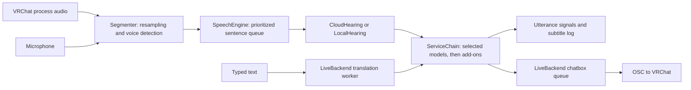

# ART – Asia realtime Translator: code map

Updated for source version **0.12.4**. The application has one service registry and one build for everyone. Repository: [ART-Asia-realtime-Translator](https://github.com/SentoMinh/ART-Asia-realtime-Translator).

Implementation history and repair notes are in [CHANGELOG.md](CHANGELOG.md), including the 0.12.2 latency change and its regression tests.

## What the app does

A Python 3.12 / PySide6 desktop companion for VRChat. It captures VRChat audio or a selected playback device for translated subtitles, translates your microphone into the OSC chatbox, and translates typed messages into that same chatbox. Conversation languages are English, Mandarin, Cantonese, Vietnamese, Japanese and Korean; interface languages remain English, Chinese and Vietnamese.

It is an always-on-top desktop window. Live audio is a mix of the other players: the production engine does not identify individual speakers, although the demo and `Utterance` structure support speaker numbers. Speech recognition and text translation are separate steps. Local hearing offers Whisper on an NVIDIA GPU or SenseVoice on CPU. Translation uses the selected online service, local NLLB with CTranslate2 on CPU, or an installed add-on.

## Working tree and exports

Source commits, local builds and published releases are separate steps. Keep previous build artifacts when preparing a new release.

Source version 0.12.4 uses one package name, `VRChat-Translator-<version>`. Provider URLs, keys and model selections belong in each user's Windows profile. Custom domain supports any compatible API endpoint.

Version [0.11.10](https://github.com/SentoMinh/ART-Asia-realtime-Translator/releases/tag/v0.11.10) is published with an EXE, ZIP, installer helper, usage notes and checksums. Its release tag identifies the built source; later documentation commits do not change the published binary. Builds use the validated native binaries from the directory supplied to `tools/build.ps1 -MixerBuild`; only `VrctMicApo.dll` and `VrctApoProducer.dll` are bundled, never the test DLL.

## Current behavior

- **I speak / They speak** each accept up to three recognition languages. **Translated to** independently selects up to three panel outputs. Microphone and typed Send → Auto chatbox messages follow every They speak choice, or custom destinations from Settings → Translation → Chatbox languages. Auto-detect follows last heard, falling back to English. An explicit Send language overrides typed destinations only; typed input uses the first I speak source. Targets are captured per utterance and shared panel/chatbox translations are requested once. `fit_lines` deduplicates and divides one 144-character message budget across microphone original plus up to three translations. Japanese and Korean participate in auto-detection and translation instead of announcement-only handling. `LANGS`, recognition language lists and translation target names must stay aligned.
- **Add Speaker words** optionally sends other players' translated and original text to the OSC chatbox. It is independent of the microphone's original-text option.
- The header shows **VRChat** plus a light, with details on hover. Device arrows select microphone and subtitle audio. Header labels/meters support dragging with native movement and a manual fallback.
- The header’s Move to VRChat button uses `vrc.chatbox.vrchat_window_origin()` to find the largest visible, non-minimized window belonging to a VRChat process. ClientToScreen/SetWindowPos use native coordinates; the overlay moves without resizing or changing z-order. Hidden/minimized/missing windows leave it in place and show a tooltip.
- Below 30% background darkness, `MainWindow.paintEvent()` leaves empty pixels at alpha zero so Windows passes input to other applications. In 0.11.11, `OverlayBackdrop` paints the selected darkness on a separate input-transparent surface directly behind the text, so the body no longer disappears below 30%. It follows overlay position, size and visibility and is disposed with it. Top controls and the typing box retain an interactive background. A standard `QSizeGrip` in the bottom-right corner resizes both dimensions; native edge hit testing accepts only the top edge and top corners at every opacity.
- `DialogPanel` embeds domain setup and local downloads in the Settings page stack, reusing the model list’s own scroll area to avoid nested scrolling. The title and sole Close button stay fixed. Closing a panel restores navigation; closing Settings cancels pending model discovery, while active downloads continue through the shared manager.
- `ui.main.run()` schedules an embedded update notice after showing the window. `Settings.last_update_notice` records the version when shown; self-checks do not run GUI startup. Update the notice text with each release.
- **Custom domain** setup saves API credentials and the fetched model catalog. Hearing and Translating each have a Connect button beside the domain selector and a model picker underneath. Each picker has a visible down-arrow action that opens its dropdown; selections save immediately and manual model entry remains available. Catalogs are bound to each domain’s URL and key fingerprint. Entering a URL and key triggers debounced discovery; model-list workers use captured inputs and UI polling, ignoring obsolete results. Settings displays the model currently in use.
- `ui/service_health.py` checks configured APIs silently on normal startup and after saved provider changes. It reports Checking connection / Online / Connection issue in Settings, with a 30-second deadline and stale-result protection. There is no startup popup. Checks use model-list/auth endpoints, not inference; custom 404 responses are reported as connection issues.
- The music dialog uses a physical-microphone APO, one app-source picker with reload, volume, source meter and one Play/Stop button. Play validates before audio starts; success messages and the separate internal-test button were removed. Missing setup asks for consent, then uses the bundled installer helper with UAC if required. See [MUSIC_SETUP.md](MUSIC_SETUP.md).

## Runtime flow

`run_ui.bat` runs the guarded source updater, then starts `ui.main`. The packaged entry point is `app.py`, which also applies downloaded updates and offers `--selfcheck` and `--mixer-setup`. `ui.main.run()` creates the backend, attaches speech, creates the window and schedules background API checks through Qt. Demo startup skips these checks.

Audio callbacks only enqueue samples. A cutting thread segments them, a hearing thread prioritizes microphone sentences, two workers translate other players, and one worker translates microphone sentences in order. Typed messages have a separate worker and `ServiceChain` instance. Qt signals deliver results to the window and chatbox queue.

## Reuse these components

| Change | Existing implementation | Relevant tests |
|---|---|---|
| Capture, microphone selection, meters | `vrc/audio.py`, `ui/live_backend.py` | `test_chatbox.py`, `test_ui.py` |
| Sentence boundaries and noise rejection | `engine/vad.py`: `Segmenter`, `SileroVad` | `test_engine.py`, `test_typing.py` |
| Recognition or language handling | `engine/stt.py`: `CloudHearing`, `LocalWhisper`, `tidy`; `engine/local_inference.py`: `LocalHearing`, `LocalSenseVoice` | `test_engine.py`, `test_local_choices.py` |
| Local translation | `engine/local_inference.py`: shared CPU `LocalTranslator`, NLLB language tokens | `test_local_choices.py` |
| Provider definitions, keys, models, HTTP errors | `engine/services.py` | `test_engine.py`, `test_ui.py` |
| Startup/provider connection checks | `ui/service_health.py`, `ui/main.py`, `SettingsWindow` | `test_service_health.py` |
| Model discovery, dropdown selection and current-model labels | `ServiceDialog`, `SettingsWindow`, `engine/services.py` | `test_model_controls.py`, `test_ui.py` |
| Translation prompts and fallback | `vrc/translate.py`, `engine/translators.py` | `test_engine.py`, `test_chatbox.py` |
| Speech scheduling and routing | `engine/speech.py` | `test_engine.py`, `test_typing.py` |
| OSC, message limits, send queue, typing dots | `vrc/chatbox.py`, `ui/live_backend.py` | `test_chatbox.py`, `test_typing.py` |
| Model downloads, resume, verification, progress | `engine/local_model.py`, `ui/local_download.py`, `LocalModelDialog` | `test_local_model.py`, `test_ui.py` |
| Window, settings, messages, translations | `ui/main_window.py`, `settings_window.py`, `log_view.py`, `config.py`, `i18n.py` | `test_ui.py` |
| Music capture, native transport, playback | `vrc/apo_music.py`, `apo_transport.py`, `apo_player.py`, `ui/music_dialog.py` | `test_apo_music.py`, `test_apo_transport.py`, `test_apo_player.py`, `test_music_dialog.py` |
| Consent, elevation, attachment, rollback | `vrc/apo_install.py`, `apo_setup.py`, `apo/` | `test_apo_install.py`, `test_apo_setup.py`, `test_apo_endpoint_audit.py` |
| Packaging and updates | `tools/build.ps1`, `tools/update.py`, `ui/updater.py`, `updates/` | `test_update.py`, `test_updater.py` |

Preserve the existing contracts: `Heard(text, lang)` for recognition; `prepare()` / `translate(..., heard=False)` and `TranslateError` for translators; `Backend` signals and same-ID `Utterance` updates for the window. Add service behavior to the registry/adapters, rather than creating another provider layer. Extend `ServiceChain` for fallback and the existing download manager for progress/resume.

Current timing rules include 0.8 seconds of end-of-speech silence, microphone/game VAD thresholds of 0.5/0.7, a 10-second stale-game-sentence limit, and separate ordered microphone translation. The chatbox implementation limits messages to 144 characters and spaces sends by 1.5 seconds. These are code settings, not newly verified external platform limits.

## Remaining review items

The earlier `local_model.NAME` Settings crash is resolved: the current label uses the selected local model's name. Model discovery no longer reads widgets in the worker or manually pumps the event loop. These older findings should not be treated as open defects.

The following paths still warrant focused tests before changing behavior:

- `_switch_hearing()` still mutates settings before signaling; its legacy fallback path can skip the main window's save path. The normal backend now also supports explicit switch prompts, so distinguish those paths.
- `ServiceChain` has both the `Chain` callback and a post-translation callback. Consumers suppress some duplicate state changes, but callback ownership still overlaps.
- Custom discovery can try `/v1/models` without changing the base URL later used for inference.
- `LiveBackend.stop()` stops capture and UI/backend timers but does not explicitly stop the attached speech engine.

These are code-review observations, not newly reproduced live failures. This documentation update does not change application behavior.

## Validation and commands

Version 0.11.10 passed **422 tests**, including opacity boundaries, top-only resize hit testing, embedded panel lifecycle and once-per-version notices. A Windows check verified an actual top-grip resize drag and, with a separate process, blank-space click-through, text/input hit testing and subtitle copying, plus detection/placement against a separate test application. Actual VRChat placement and mixed-DPI monitors were not tested live. Packaged checks verified the self-check, bundled runtimes, production mixer DLL hashes, committed-source match, source/artifact scans, ZIP integrity and uploaded asset checksums.

The GitHub download and packaged replacement/restart from 0.11.9 to 0.11.10 passed, as did the new-version self-check and no-update check. Earlier source checks exercised SenseVoice and NLLB CPU inference; they were not rerun for this UI update. Whisper large-v3 GPU inference remains untested. Verify each new binary separately.

Prior live tests verified the development HyperX QuadCast APO attachment and selected-app injection on this Windows 11 PC. Fresh-PC installation, live Windows 10 behavior, other microphones and signed public deployment remain unverified. Japanese/Korean routing tests use fake services; there is no new live recognition benchmark for them.

- Launch directly: `.venv-app\Scripts\python.exe -m ui.main`; add `--demo` for example messages. Direct launch skips `run_ui.bat`'s Git updater.
- Build: `pwsh -File tools\build.ps1 -MixerBuild .tools\apo-prototype-10`; substitute your validated native build. Add `-Folder` for a folder build. Packaging without a mixer path does not explicitly bundle native mixer binaries.
- UI render tool: `tools/snapshot_ui.py`.
- Quality evaluation: `bench/README.md`, `BENCHMARK.md` and `bench/results/`. Benchmark adapters are experiments, not a second production engine. Their environments and real service calls are separate from unit tests.
- Build assets are explicitly selected in `tools/build.ps1`; personal provider configuration is never bundled.

Follow the user’s current authorization for commits, builds and GitHub publication; clarify only when the requested scope is unclear. Preserve existing release artifacts and unrelated working-tree edits. A documentation-only commit does not require rebuilding the EXE or moving its release tag.

## Next feature discussion

Read [ROADMAP.md](ROADMAP.md). Voice recognition is the priority; speaker identification is deferred. Mention that saved idea when planning future work. Temporary demo previews must be closed after verification.

Source 0.11.11 passed 424 tests. A native Windows check measured the composed body pixels at 0/28/29/30/31% over a separate white window, verified smooth darkness across the threshold, click-through below 30%, text/input interaction, subtitle copy, and background alignment/visibility. Package and upgrade results belong to the corresponding release notes.

Source 0.11.12 replaces the header resize button with a standard bottom-right `QSizeGrip`, including at low opacity and with hidden controls. `SelectableText` in `ui/log_view.py` uses Qt selection: release after dragging copies only the selection; a plain click retains original-text copying. Original and both translation blocks support selection and Ctrl+C.

Source 0.11.12 passed 428 tests, including corner resizing, partial copying from all three text blocks, click-to-copy compatibility and Ctrl+C. Native Windows checks verified the corner remains interactive with hidden controls/below 30% opacity and that dragging copies only the selected subtitle text.

Source 0.11.13 adds `ui/language_picker.py` checkable dropdowns and migrates legacy scalar/second-language settings into validated lists. `Utterance.panel_targets` captures display choices before translation starts; `panel_translations` carries up to three results. `vrc.translate.translate_targets` deduplicates shared chatbox/panel destinations, reuses the original for a matching source, and keeps successes when another target fails. Both speech and typed jobs use it. Multiple recognition choices use language detection plus a selected-language filter; this does not add simultaneous-speaker identification.

Source 0.11.13 passed 434 tests, covering language selection and limits, legacy migration, recognition preferences/filtering, three panel outputs, partial failures, captured destinations, chatbox separation and partial copying from the third translation. Native Windows captures verified the three pickers fit at 440 pixels in English, Chinese and Vietnamese; all preview windows closed automatically. Live multilingual microphone/VRChat recognition and external translation services were not exercised for this change.

Version 0.12.1 republishes the three-language selection feature under the requested version number. Application behavior is unchanged from 0.11.13; release assets are rebuilt from the versioned source.

Version 0.12.2 displays each completed panel translation while later targets continue. `translate_targets(on_result=...)` reports snapshots after intermediate successes; speech and typed workers emit separate non-final utterance copies with the same ID. `LogRow` renders available outputs and a translating indicator, preserving selections in unchanged labels. Final error handling and one-time chatbox sending remain in the existing completion paths. Request order/count, model parameters, recognition thresholds, fallback cooldowns and OSC pacing are unchanged.

A controlled five-run benchmark with 120 ms per translation measured median first-panel-result latency of 361.0 ms before and 120.5 ms after for three destinations. Total completion was 361.0 / 361.2 ms; one destination was 120.3 / 120.5 ms. This isolates display waiting, not real server or speech-recognition speed. Source checks cover partial failures, immutable snapshots, row reuse, selection retention and Qt worker delivery while a later translation is blocked; live audio and external-service latency require separate measurements.

Version 0.12.3 detects a validated mixer attached to another microphone using `apo_install.registered_microphone()`. The music dialog names it and offers a selection button that revalidates the installed files/registry and resolves an active endpoint before changing and saving the translator microphone. It suppresses the futile second-install prompt; the installer also reports the existing device before requesting UAC. Moving an attachment still requires explicit removal using its journal.

Local NLLB translation in 0.12.3 batches punctuated sentences separately to avoid losing later sentences. `translation_sentences` keeps common abbreviations and decimal points together. `translation_loop` guards pathological expansion with repeated token sequences; only an affected sentence gets one retry with a four-token repetition limit. Empty/missing sentence results or a repeated retry raise `TranslateError`. Greedy decoding and the model lock stay unchanged for normal translations. See `CHANGELOG.md` and `tests/test_local_translation_quality.py` for the reproduced cases, diagnostics and limits.
