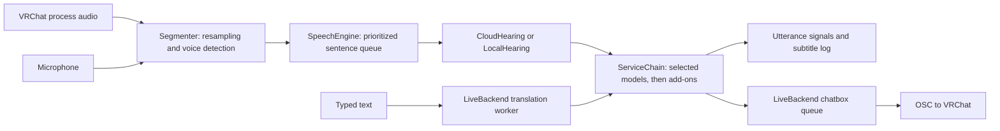

# ART – Asia realtime Translator: code map

Updated for source version **0.11.9**. The application has one service registry and one build for everyone. Repository: [ART-Asia-realtime-Translator](https://github.com/SentoMinh/ART-Asia-realtime-Translator).

## What the app does

A Python 3.12 / PySide6 desktop companion for VRChat. It captures VRChat audio or a selected playback device for translated subtitles, translates your microphone into the OSC chatbox, and translates typed messages into that same chatbox. Conversation languages are English, Mandarin, Cantonese, Vietnamese, Japanese and Korean; interface languages remain English, Chinese and Vietnamese.

It is an always-on-top desktop window. Live audio is a mix of the other players: the production engine does not identify individual speakers, although the demo and `Utterance` structure support speaker numbers. Speech recognition and text translation are separate steps. Local hearing offers Whisper on an NVIDIA GPU or SenseVoice on CPU. Translation uses the selected online service, local NLLB with CTranslate2 on CPU, or an installed add-on.

## Working tree and exports

Source commits, local builds and published releases are separate steps. Keep previous build artifacts when preparing a new release.

Source version 0.11.9 uses one package name, `VRChat-Translator-<version>`. Provider URLs, keys and model selections belong in each user's Windows profile. Custom domain supports any compatible API endpoint.

Existing 0.11.5 exports and reports are historical artifacts. This source update does not rebuild or publish them. Builds use the validated native binaries from the directory supplied to `tools/build.ps1 -MixerBuild`; only `VrctMicApo.dll` and `VrctApoProducer.dll` are bundled, never the test DLL.

## Current behavior

- Voice translation uses **I speak / They speak**. Typed messages use the independent **Send** language. Japanese and Korean participate in auto-detection and translation instead of announcement-only handling. `LANGS`, recognition language lists and translation target names must stay aligned.
- **Add Speaker words** optionally sends other players' translated and original text to the OSC chatbox. It is independent of the microphone's original-text option.
- The header shows **VRChat** plus a light, with details on hover. Device arrows select microphone and subtitle audio. Header labels/meters support dragging with native movement and a manual fallback.
- **Custom domain** setup saves API credentials and the fetched model catalog. Hearing and Translating each have a Connect button beside the domain selector and a model picker underneath; selections save immediately. Catalogs are bound to each domain’s URL and key fingerprint. Entering a URL and key triggers debounced discovery; model-list workers use captured inputs and UI polling, ignoring obsolete results. Settings displays the model currently in use.
- `ui/service_health.py` checks configured APIs silently on normal startup and after saved provider changes. It reports Checking connection / Online / Connection issue in Settings, with a 30-second deadline and stale-result protection. There is no startup popup. Checks use model-list/auth endpoints, not inference; custom 404 responses are reported as connection issues.
- The music dialog uses a physical-microphone APO, one app-source picker with reload, volume, source meter and one Play/Stop button. Play validates before audio starts; success messages and the separate internal-test button were removed. Missing setup asks for consent, then uses the bundled installer helper with UAC if required. See [MUSIC_SETUP.md](MUSIC_SETUP.md).

## Runtime flow

`run_ui.bat` runs the guarded source updater, then starts `ui.main`. The packaged entry point is `app.py`, which also applies downloaded updates and offers `--selfcheck` and `--mixer-setup`. `ui.main.run()` creates the backend, attaches speech, creates the window and schedules background API checks through Qt. Demo startup skips these checks.

Audio callbacks only enqueue samples. A cutting thread segments them, a hearing thread prioritizes microphone sentences, two workers translate other players, and one worker translates microphone sentences in order. Typed messages have a separate worker and `ServiceChain` instance. Qt signals deliver results to the window and chatbox queue.

## Reuse these components

| Change | Existing implementation | Relevant tests |
|---|---|---|
| Capture, microphone selection, meters | `vrc/audio.py`, `ui/live_backend.py` | `test_chatbox.py`, `test_ui.py` |
| Sentence boundaries and noise rejection | `engine/vad.py`: `Segmenter`, `SileroVad` | `test_engine.py`, `test_typing.py` |
| Recognition or language handling | `engine/stt.py`: `CloudHearing`, `LocalWhisper`, `tidy`; `engine/local_inference.py`: `LocalHearing`, `LocalSenseVoice` | `test_engine.py`, `test_local_choices.py` |
| Local translation | `engine/local_inference.py`: shared CPU `LocalTranslator`, NLLB language tokens | `test_local_choices.py` |
| Provider definitions, keys, models, HTTP errors | `engine/services.py` | `test_engine.py`, `test_ui.py` |
| Startup/provider connection checks | `ui/service_health.py`, `ui/main.py`, `SettingsWindow` | `test_service_health.py` |
| Model discovery and current-model labels | `ServiceDialog`, `SettingsWindow`, `engine/services.py` | `test_model_controls.py`, `test_ui.py` |
| Translation prompts and fallback | `vrc/translate.py`, `engine/translators.py` | `test_engine.py`, `test_chatbox.py` |
| Speech scheduling and routing | `engine/speech.py` | `test_engine.py`, `test_typing.py` |
| OSC, message limits, send queue, typing dots | `vrc/chatbox.py`, `ui/live_backend.py` | `test_chatbox.py`, `test_typing.py` |
| Model downloads, resume, verification, progress | `engine/local_model.py`, `ui/local_download.py`, `LocalModelDialog` | `test_local_model.py`, `test_ui.py` |
| Window, settings, messages, translations | `ui/main_window.py`, `settings_window.py`, `log_view.py`, `config.py`, `i18n.py` | `test_ui.py` |
| Music capture, native transport, playback | `vrc/apo_music.py`, `apo_transport.py`, `apo_player.py`, `ui/music_dialog.py` | `test_apo_music.py`, `test_apo_transport.py`, `test_apo_player.py`, `test_music_dialog.py` |
| Consent, elevation, attachment, rollback | `vrc/apo_install.py`, `apo_setup.py`, `apo/` | `test_apo_install.py`, `test_apo_setup.py`, `test_apo_endpoint_audit.py` |
| Packaging and updates | `tools/build.ps1`, `tools/update.py`, `ui/updater.py`, `updates/` | `test_update.py`, `test_updater.py` |

Preserve the existing contracts: `Heard(text, lang)` for recognition; `prepare()` / `translate(..., heard=False)` and `TranslateError` for translators; `Backend` signals and same-ID `Utterance` updates for the window. Add service behavior to the registry/adapters, rather than creating another provider layer. Extend `ServiceChain` for fallback and the existing download manager for progress/resume.

Current timing rules include 0.8 seconds of end-of-speech silence, microphone/game VAD thresholds of 0.5/0.7, a 10-second stale-game-sentence limit, and separate ordered microphone translation. The chatbox implementation limits messages to 144 characters and spaces sends by 1.5 seconds. These are code settings, not newly verified external platform limits.

## Remaining review items

The earlier `local_model.NAME` Settings crash is resolved: the current label uses the selected local model's name. Model discovery no longer reads widgets in the worker or manually pumps the event loop. These older findings should not be treated as open defects.

The following paths still warrant focused tests before changing behavior:

- `_switch_hearing()` still mutates settings before signaling; its legacy fallback path can skip the main window's save path. The normal backend now also supports explicit switch prompts, so distinguish those paths.
- `ServiceChain` has both the `Chain` callback and a post-translation callback. Consumers suppress some duplicate state changes, but callback ownership still overlaps.
- Custom discovery can try `/v1/models` without changing the base URL later used for inference.
- `LiveBackend.stop()` stops capture and UI/backend timers but does not explicitly stop the attached speech engine.

These are code-review observations, not newly reproduced live failures. This documentation update does not change application behavior.

## Validation and commands

Source version 0.11.9 passed **400 tests**, plus actual SenseVoice and NLLB CPU inference checks. Packaged self-checks cover the bundled runtimes and microphone mixer. Whisper large-v3 has not been run with downloaded weights on a GPU.

Historical 0.11.5 package validation covered tests, packaged self-checks, Japanese/Korean language tables, native DLL hashes, privacy scans and ZIP checksums. Run tests and packaged checks again for each new release.

Prior live tests verified the development HyperX QuadCast APO attachment and selected-app injection on this Windows 11 PC. Fresh-PC installation, live Windows 10 behavior, other microphones and signed public deployment remain unverified. Japanese/Korean routing tests use fake services; there is no new live recognition benchmark for them.

- Launch directly: `.venv-app\Scripts\python.exe -m ui.main`; add `--demo` for example messages. Direct launch skips `run_ui.bat`'s Git updater.
- Build: `pwsh -File tools\build.ps1 -MixerBuild .tools\apo-prototype-10`; substitute your validated native build. Add `-Folder` for a folder build. Packaging without a mixer path does not explicitly bundle native mixer binaries.
- UI render tool: `tools/snapshot_ui.py`.
- Quality evaluation: `bench/README.md`, `BENCHMARK.md` and `bench/results/`. Benchmark adapters are experiments, not a second production engine. Their environments and real service calls are separate from unit tests.
- Build assets are explicitly selected in `tools/build.ps1`; personal provider configuration is never bundled.

Ask before each new export, as requested by the user. A local export does not authorize publication or imply that the working tree has been committed. Preserve existing exports and unrelated working-tree edits.
